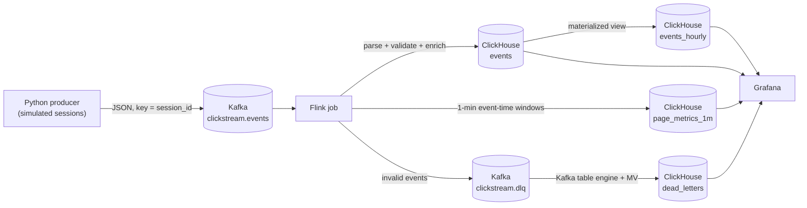

# Real-Time Clickstream Analytics Platform

**Kafka · Apache Flink · ClickHouse · Grafana · Docker**

An end-to-end streaming analytics platform that ingests e-commerce clickstream events, validates and enriches them in Apache Flink, computes event-time window aggregates, and serves sub-second analytical queries from ClickHouse, with live Grafana dashboards on top.

The whole stack starts with one command and includes a realistic traffic simulator (user sessions moving through a purchase funnel, plus deliberately late and malformed events) so every part of the pipeline is exercised.

---

## Architecture



### Flink job topology

```
KafkaSource (raw JSON strings)
  └─ EventParserFunction ── side output ──► KafkaSink (clickstream.dlq)
       └─ EventEnricher (device type, URL / referrer / country normalisation)
            └─ Watermarks (bounded out-of-orderness + idleness)
                 ├─ ClickHouseSink ──► analytics.events
                 └─ keyBy(page_url, event_type)
                      └─ Tumbling 1-min event-time window (+ allowed lateness)
                           └─ AggregateFunction + ProcessWindowFunction
                                └─ ClickHouseSink ──► analytics.page_metrics_1m
```

## Tech stack

| Layer | Technology | Purpose |
|---|---|---|
| Event source | Python 3.11, confluent-kafka | Simulates sessions, funnels, late and invalid events |
| Message bus | Apache Kafka 3.7 (KRaft, no ZooKeeper) | Durable, partitioned event log |
| Stream processing | Apache Flink 1.18 (Java 11, DataStream API) | Validation, enrichment, event-time windowing |
| OLAP storage | ClickHouse 24.3 LTS | Columnar storage, materialized views, Kafka engine |
| Visualisation | Grafana 10.4 + ClickHouse plugin | Real-time dashboard (auto-provisioned) |
| Tooling | Docker Compose, Make, GitHub Actions | One-command setup, CI |

## Highlights

- **Dead-letter queue instead of job failures.** Malformed JSON, unknown event types, bad timestamps and business-rule violations are routed to a Kafka DLQ with a categorised error. ClickHouse consumes that topic directly with its **Kafka table engine**, so data-quality issues are queryable and visible on the dashboard.
- **Event-time processing.** Watermarks with bounded out-of-orderness, idle-source handling and allowed lateness. Late events re-fire their window with an updated result.
- **Idempotent writes on an at-least-once sink.** The custom ClickHouse sink batches rows over the HTTP interface and flushes synchronously on every checkpoint, so no data is lost on failure. Replayed rows are absorbed by `ReplacingMergeTree`. Window results carry a deterministic version (a per-window fire counter kept in Flink state), so ClickHouse always keeps the most complete result.
- **No Kryo fallback.** `disableGenericTypes()` is enabled and the window accumulator declares explicit Flink type information, so all state uses Flink's native serializers.
- **ClickHouse-native modelling.** `LowCardinality`, Delta + ZSTD codecs, bloom-filter skip indexes, TTLs, an `AggregatingMergeTree` hourly rollup fed by a materialized view, and `windowFunnel` for conversion analysis.
- **Retries with exponential backoff** for transient ClickHouse errors (5xx/429), fail-fast on client errors, Flink restart strategy and retained checkpoints.
- **Tested.** Unit tests for parsing, enrichment, aggregation, row mapping and configuration (JUnit 5, pytest), plus CI that builds both modules and validates the Compose file.

## Project structure

```
realtime-clickstream-analytics/
├── docker-compose.yml              # Full stack: Kafka, Flink, ClickHouse, Grafana, producer
├── Makefile                        # make up / smoke / test / logs / clean ...
├── .env.example                    # Credentials and tunables
├── .github/workflows/ci.yml        # Build + test both modules, validate compose
├── infra/
│   ├── kafka/create-topics.sh      # Idempotent topic creation
│   ├── clickhouse/init/            # Schema, executed on first ClickHouse start
│   │   ├── 01_database.sql
│   │   ├── 02_events.sql           # ReplacingMergeTree raw events
│   │   ├── 03_page_metrics.sql     # Flink window output, versioned
│   │   ├── 04_hourly_rollup.sql    # AggregatingMergeTree + materialized view
│   │   └── 05_dead_letters.sql     # Kafka engine -> MV -> MergeTree
│   └── grafana/                    # Datasource + dashboard provisioning
├── producer/                       # Python event simulator
│   ├── Dockerfile
│   ├── src/clickstream_producer/
│   │   ├── config.py               # Env-based configuration
│   │   ├── models.py               # Event model / wire format
│   │   ├── catalog.py              # Products, pages, referrers, devices
│   │   ├── generator.py            # Session state machine + fault injection
│   │   ├── kafka_client.py         # Idempotent Kafka producer wrapper
│   │   └── main.py                 # Rate-limited run loop
│   └── tests/
├── flink-job/                      # Java Flink job (Maven)
│   ├── Dockerfile                  # Multi-stage: Maven build -> Flink image
│   ├── pom.xml
│   └── src/main/java/com/example/clickstream/
│       ├── ClickstreamJob.java     # Pipeline wiring
│       ├── config/                 # JobConfig, StreamEnvironmentFactory
│       ├── model/                  # ClickEvent, PageMetric, EventType
│       ├── parsing/                # ClickEventParser (pure, unit-tested)
│       ├── processing/             # Parser function, enricher, window aggregation
│       ├── sink/                   # ClickHouse HTTP sink, row mappers, DLQ sink
│       ├── source/                 # Kafka source
│       ├── time/                   # Watermark strategy
│       └── util/                   # JSON + time helpers
├── sql/analytics_queries.sql       # Query cookbook
└── scripts/smoke-test.sh           # End-to-end verification
```

## Getting started

### Prerequisites

- Docker 24+ with Docker Compose v2
- About 6 GB of free memory for the containers
- Optional, for running tests locally: Java 11 + Maven 3.9, Python 3.10+

### Run

```bash
git clone https://github.com/<your-username>/realtime-clickstream-analytics.git
cd realtime-clickstream-analytics

make up        # creates .env, builds the images and starts everything
make smoke     # waits for data to reach ClickHouse and prints a summary
```

The first build downloads Maven dependencies and images, so it takes a few minutes. Without `make`:

```bash
cp .env.example .env
docker compose up -d --build
bash scripts/smoke-test.sh
```

### Service URLs

| Service | URL | Login |
|---|---|---|
| Grafana dashboard | http://localhost:3000 | `admin` / `admin` |
| Flink Web UI | http://localhost:8081 | none |
| Kafka UI | http://localhost:8080 | none |
| ClickHouse Play (SQL in browser) | http://localhost:8123/play | `analytics` / `analytics_pwd` |
| Kafka (from host) | `localhost:29092` | none |

## Data model

| Table | Engine | Written by | Contents |
|---|---|---|---|
| `events` | ReplacingMergeTree(processed_at) | Flink | Validated, enriched raw events (90-day TTL) |
| `page_metrics_1m` | ReplacingMergeTree(version) | Flink | 1-minute counts, distinct users/sessions, revenue per page and event type |
| `events_hourly` | AggregatingMergeTree | Materialized view on `events` | Hourly partial aggregates by event type, country, device |
| `events_hourly_v` | View | | Merged, ready-to-query hourly rollup |
| `dead_letters` | MergeTree | Kafka engine + MV | Rejected events with error type and raw payload (30-day TTL) |

Event wire format (Kafka value, key = `session_id`):

```json
{
  "event_id": "f1fd42a2-9755-44c1-ba90-2931cd447e35",
  "event_type": "add_to_cart",
  "user_id": "u_000097",
  "session_id": "a6cecc1b-78e5-4061-b311-d8a3c2ce6f44",
  "page_url": "/products/spo-0007",
  "referrer": "https://www.google.com/",
  "product_id": "spo-0007",
  "price": 151.8,
  "quantity": 1,
  "user_agent": "Mozilla/5.0 (iPhone; ...)",
  "country": "DE",
  "event_time": "2026-11-10T11:30:32.804Z"
}
```

## Design decisions

**Why parse in Flink rather than in the Kafka deserializer?** A deserializer that throws stops the source. Reading raw strings and parsing in a `ProcessFunction` lets invalid records go to a side output and on to the DLQ while valid traffic keeps flowing.

**Delivery guarantees.** Kafka offsets are committed on checkpoints, and the ClickHouse sink flushes its buffer inside `snapshotState`, so every row before a checkpoint barrier is stored before that checkpoint completes. After a failure, Flink replays from the last checkpoint, which can write some rows twice. Rather than paying for two-phase commit, the tables are designed to be idempotent: `events` deduplicates on its sorting key (which contains `event_id`), and `page_metrics_1m` keeps the highest `version`. Use `FINAL` (or `argMax`) when exact numbers matter before background merges have run.

**Late data.** Watermarks trail the highest event time by 5 seconds. Windows stay open for 2 more minutes of allowed lateness; each late event re-fires its window with a higher version. Events later than that are still stored in `events` but are not counted in `page_metrics_1m`.

**Why a custom ClickHouse sink?** The HTTP interface with `JSONEachRow` is ClickHouse's most robust ingestion path, needs no JDBC driver, and makes batching, retry and backoff behaviour explicit and testable.

**Known trade-off.** The hourly materialized view sees rows at insert time, before deduplication, so replayed rows can slightly inflate `events` and `revenue` in the rollup after a Flink restart. `uniq` columns are unaffected.

## Configuration

Everything is configured through `.env` (see `.env.example`). The Flink job reads environment variables or program arguments (`--sink.batch-size 10000`):

| Variable | Default | Description |
|---|---|---|
| `EVENTS_PER_SECOND` | 50 | Producer throughput |
| `INVALID_EVENT_RATIO` | 0.02 | Share of deliberately invalid events |
| `LATE_EVENT_RATIO` | 0.05 | Share of events with event time 5–120 s in the past |
| `SINK_BATCH_SIZE` | 5000 | Rows per ClickHouse insert |
| `SINK_FLUSH_INTERVAL_MS` | 2000 | Max time between inserts while events arrive |
| `CHECKPOINT_INTERVAL_MS` | 10000 | Checkpoint interval (also bounds sink latency) |
| `MAX_OUT_OF_ORDERNESS_MS` | 5000 | Watermark delay |
| `WINDOW_SIZE_SECONDS` | 60 | Tumbling window size |
| `ALLOWED_LATENESS_SECONDS` | 120 | How long windows accept late events |
| `FLINK_PARALLELISM` | 2 | Default job parallelism |

## Example queries

See [`sql/analytics_queries.sql`](sql/analytics_queries.sql) for the full cookbook: funnel analysis with `windowFunnel`, top products, rollup queries, session statistics, pipeline latency percentiles, late-window inspection, DLQ analysis, duplicate monitoring and storage/compression stats.

```sql
-- Sessions reaching each funnel step in the last day
WITH funnel AS (
    SELECT session_id,
           windowFunnel(3600)(toDateTime(event_time),
               event_type = 'page_view', event_type = 'product_view',
               event_type = 'add_to_cart', event_type = 'checkout_start',
               event_type = 'purchase') AS level
    FROM analytics.events
    WHERE event_time >= now() - INTERVAL 1 DAY
    GROUP BY session_id
)
SELECT countIf(level >= 1) AS visited, countIf(level >= 3) AS carted, countIf(level >= 5) AS purchased
FROM funnel;
```

## Testing

```bash
make test          # both modules
make test-java     # JUnit 5: parser, enricher, aggregator, row mappers, config
make test-python   # pytest: generator, config, models
```

CI (`.github/workflows/ci.yml`) runs both test suites and validates `docker-compose.yml` on every push and pull request.

## Operations

```bash
make logs s=flink-jobmanager   # follow one service
make ch-client                 # interactive ClickHouse client
make topics                    # describe Kafka topics
make dlq                       # peek at dead-letter messages
make down                      # stop (keeps data)
make clean                     # stop and delete all volumes
```

Change the load by editing `EVENTS_PER_SECOND` in `.env` and running `docker compose up -d producer`.

## Troubleshooting

- **Flink job keeps restarting:** check `make logs s=flink-jobmanager`. The most common cause is wrong ClickHouse credentials in `.env`, or a schema change that wasn't applied (see below).
- **No data in Grafana:** run `make smoke`; confirm the time range is "Last 30 minutes" and the producer is running (`make logs s=producer`).
- **Schema changes not applied:** ClickHouse init scripts only run on an empty volume. Run `make clean && make up`.
- **Port already in use:** change the host port mapping in `docker-compose.yml`.

## Roadmap

- Schema Registry with Avro/Protobuf instead of JSON
- HyperLogLog sketches for distinct counts at very high cardinality
- Session windows for session-level metrics computed in Flink
- Replicated ClickHouse cluster with ClickHouse Keeper
- Prometheus metrics from Flink and alerting on DLQ rate

## License

MIT, see [LICENSE](LICENSE).
