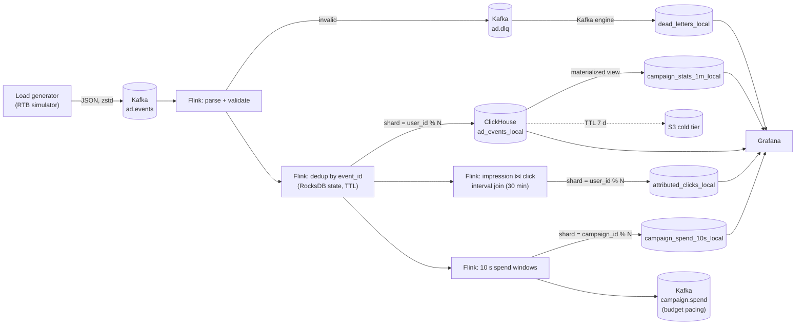

# Real-Time Ad-Tech Analytics on ClickHouse (30+ TB/month)

**Kafka · Apache Flink · ClickHouse cluster (sharded + replicated, S3 tiering) · ClickHouse Keeper · Prometheus · Grafana · Kubernetes**

A streaming analytics platform for real-time bidding (RTB) traffic: bids, impressions, clicks and conversions from ad exchanges. Flink deduplicates the stream, attributes clicks to impressions, and computes real-time campaign spend for budget pacing. A sharded, replicated ClickHouse cluster stores the raw firehose with hot/cold tiering to S3 and serves sub-second dashboards from materialized-view rollups.

The production design is sized for **30+ TB of raw events per month** (~1 TB/day, ~27k events/s average, ~80–100k events/s peak). A scaled-down replica of the same topology (2 shards × 2 replicas, Keeper, MinIO as S3) runs locally with one command.

---

## Architecture



ClickHouse cluster: every `*_local` table is a `Replicated*MergeTree` on each shard with a `Distributed` table on top for reads; replicas coordinate through ClickHouse Keeper.

## Scale at a glance

| | Value | Source |
|---|---|---|
| Raw ingest | 30 TB/month ≈ 1 TB/day | design target |
| Events | 2.36 B/day, 27k/s average, ~82k/s peak | 423 B/event, measured |
| ClickHouse footprint | **58 B/row** compressed → 137 GB/day per replica set (**7.3x** smaller than raw JSON) | measured on this schema |
| Hot tier | 7 days ≈ 240 GB per node on NVMe | |
| Cold tier | ≈ 17 TB on S3 (bids kept 30 days, other events 180 days) | |
| Kafka | 48 partitions, zstd (**5.2x**), 3-day retention, RF 3 | measured ratio |
| Flink | parallelism 48; parse path **~270k events/s per core** | measured |
| ClickHouse inserts | ~0.4 inserts/s per shard, ~17k-row gzip batches | |

Full derivation: [docs/capacity-planning.md](docs/capacity-planning.md).

## Engineering highlights

- **Shard-aware Flink sink.** Rows are routed to `shard = key % shards` (unsigned), exactly as the Distributed engine computes it, and written straight into `*_local` tables. A custom partitioner gives each sink subtask exactly one shard, so batches stay large and the insert rate per shard stays below one per second.
- **Duplicate-free without `FINAL`.** Flink deduplicates by `event_id` with RocksDB state and TTL. Each insert batch carries an `insert_deduplication_token`, so a request that timed out after committing and is retried on the *other* replica is ignored by Keeper-backed deduplication, including in materialized views.
- **Replica failover** with exponential backoff per round, fail-fast on 4xx, and gzip request bodies.
- **Co-location by `user_id`.** A request's whole funnel (bid → impression → click → conversion) lives on one shard, so funnels and frequency analysis run shard-locally.
- **Real-time attribution and pacing.** An event-time interval join attributes clicks within 30 minutes. 10-second spend windows go to ClickHouse and to a compacted Kafka topic for a pacing service. Late impressions re-fire windows with a monotonic version kept in Flink state.
- **ClickHouse modelling for volume.** Daily partitions, `Enum8`/`UUID`/`LowCardinality` types, `DoubleDelta`/`T64` codecs, bloom-filter skip indexes, an aggregate **projection** for publisher reports, conditional TTL (`DELETE WHERE event_type = 'bid'`), hot/cold **S3 tiering** with a local cache, a replicated dimension table exposed as a **dictionary**, and an `AggregatingMergeTree` rollup.
- **Operations.** Prometheus metrics from Flink (custom counters), ClickHouse and Kafka lag, alert rules for lag, checkpoint failures, DLQ rate, too many parts and replication delay, two Grafana dashboards, and a runbook.
- **Production manifests.** Strimzi Kafka (KRaft), Altinity ClickHouse operator (4 × 2 + Keeper ×3), and Flink Kubernetes Operator with savepoint upgrades and HA.

## How it was verified

| Check | Result |
|---|---|
| Java unit tests (parser, routing, HTTP failover against a live HTTP server, mappers, aggregation, config) | 45 passing |
| Python unit tests (simulator, faults, ids, config) | 21 passing |
| Full Flink graph on a local mini-cluster, 27.7k events (1% duplicates, 0.5% invalid, 2% late), fake 2×2 cluster with one lost-ack and one 503 | All 27,278 unique valid events stored exactly once, every row on the correct shard, both replicas used, retry deduplicated by token. 351/351 attributions and 3,813/3,813 spend windows matched an independent recomputation exactly. |
| All schema DDL, cookbook queries and dashboard SQL on embedded ClickHouse (`scripts/validate_sql.py`, also in CI) | valid; publisher query confirmed to read the projection |

Testing also caught and fixed real issues: unaligned checkpoints are rejected by Flink with custom partitioners, two ClickHouse alias-shadowing errors in queries, a filter that silently bypassed the projection, and a shard-spec parsing edge case that could have changed the shard count.

## Project structure

```
realtime-adtech-analytics/
├── docker-compose.yml               # local 2x2 ClickHouse cluster + Keeper + MinIO + Kafka + Flink + monitoring
├── Makefile                         # up / smoke / test / benchmark / rate / ...
├── .github/workflows/ci.yml         # Java, Python, SQL validation, dashboards, compose
├── docs/
│   ├── architecture.md              # design decisions, guarantees, failure modes
│   ├── capacity-planning.md         # 30+ TB/month sizing with measured inputs
│   └── operations-runbook.md        # scaling, schema changes, replays, incidents
├── k8s/                             # production manifests (Strimzi, Altinity, Flink operator)
├── infra/
│   ├── clickhouse/
│   │   ├── config.d/                # cluster + macros (from env), S3 storage policy, server
│   │   ├── users.d/                 # users and profiles
│   │   ├── keeper/                  # ClickHouse Keeper config
│   │   └── schema/                  # 01..07 *.sql, all ON CLUSTER
│   ├── kafka/create-topics.sh
│   ├── prometheus/                  # scrape config + alert rules
│   └── grafana/                     # datasources + generated dashboards
├── flink-job/                       # Java 11 / Flink 1.18 (Maven)
│   └── src/main/java/com/example/adtech/
│       ├── AdAnalyticsJob.java      # pipeline wiring
│       ├── config/                  # JobConfig, StreamEnvironmentFactory
│       ├── model/                   # AdEvent, AttributedClick, CampaignSpend, EventType
│       ├── parsing/                 # AdEventParser, FieldNormalizer
│       ├── processing/              # dedup, attribution join, spend windows, DLQ
│       ├── sink/                    # sharded ClickHouse sink, router, HTTP client, mappers, Kafka sinks
│       ├── source/ time/ util/
├── generator/                       # Python RTB simulator (multi-process)
│   └── src/adgen/                   # config, ids, catalog, models, simulator, faults, kafka_client, worker, main
├── sql/analytics_queries.sql        # business + ops query cookbook
├── benchmarks/queries.sql           # clickhouse-benchmark workload
└── scripts/                         # apply-schema, smoke-test, benchmark, validate_sql, build_dashboards
```

## Run it locally

Requirements: Docker with Compose v2 and about **10–12 GB RAM** for the containers.

```bash
git clone https://github.com/<your-username>/realtime-adtech-analytics.git
cd realtime-adtech-analytics
make up        # builds images, starts everything, applies the schema ON CLUSTER
make smoke     # waits for data on every table/shard and checks sharding correctness
```

| Service | URL | Login |
|---|---|---|
| Grafana (folder "Ad-Tech") | http://localhost:3000 | admin / admin |
| Flink | http://localhost:8081 | none |
| Kafka UI | http://localhost:8080 | none |
| ClickHouse Play | http://localhost:8123/play | adtech / adtech_pwd |
| Prometheus | http://localhost:9090 | none |
| MinIO console | http://localhost:9001 | minioadmin / minioadmin123 |

Useful commands:

```bash
make rate eps=10000 workers=4   # push more load
make benchmark c=8 n=500        # query benchmark with clickhouse-benchmark
make ch-client                  # SQL shell on shard 1, replica 1
make logs s=flink-jobmanager
make clean                      # remove everything including volumes
```

## Configuration

Everything is driven by environment variables (`.env`, `docker-compose.yml`) or Flink program arguments.

| Variable | Default | Meaning |
|---|---|---|
| `CLICKHOUSE_SHARDS` | `r1,r2;r1,r2` URLs | shards separated by `;`, replicas by `,`; order must match `remote_servers` |
| `SINK_WRITERS_PER_SHARD` | 1 (local), 2 (prod) | sink subtasks per shard |
| `SINK_BATCH_ROWS` / `SINK_BATCH_BYTES` / `SINK_FLUSH_INTERVAL_MS` | 100000 / 64 MB / 5000 | batch limits (also flushed on every checkpoint) |
| `DEDUP_TTL_MS` | 3600000 | how long an `event_id` is remembered |
| `ATTRIBUTION_WINDOW_MS` | 1800000 | click must follow the impression within this window |
| `MAX_OUT_OF_ORDERNESS_MS` | 15000 | watermark delay |
| `SPEND_WINDOW_SECONDS` / `SPEND_ALLOWED_LATENESS_SECONDS` | 10 / 60 | pacing windows |
| `EVENTS_PER_SECOND`, `GENERATOR_WORKERS` | 2000, 2 | load generator rate |

## Tests

```bash
make test-java     # mvn verify (JUnit 5)
make test-python   # pytest
make test-sql      # every DDL, cookbook query and dashboard query on embedded ClickHouse
```

## Production

See [k8s/README.md](k8s/README.md) for deploying with Strimzi, the Altinity ClickHouse operator and the Flink Kubernetes Operator, and [docs/operations-runbook.md](docs/operations-runbook.md) for day-2 operations.

## Roadmap

- Protobuf/Avro with a schema registry instead of JSON on the wire
- RowBinary encoding in the sink to cut ClickHouse parse CPU further
- Conversion attribution (click ⋈ conversion, 7-day window) in Flink
- Exactly-once sink via checkpoint-aligned batches and deterministic dedup tokens
- Automated load test in CI on an ephemeral Kubernetes cluster

## License

MIT, see [LICENSE](LICENSE).
